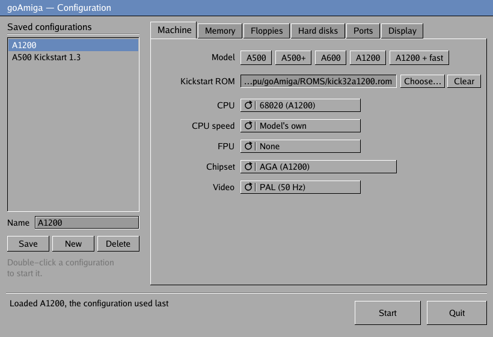
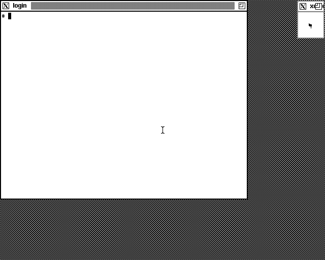

# goAmiga

An Amiga emulator written in Go, from the 68000 up. It runs Kickstart and
Workbench, games and demos (copy-protected originals included), from the
A500 to the A1200. It has its own 680x0 CPU core, in [`m68k/`](m68k/).



## What it emulates

**Machines:**
- 68000, 68020, 68030 or 68040 CPU (the 68030 and 68040 with their
  MMUs), with an optional 68881/68882 FPU; the 68040 has its own.
- OCS, ECS or AGA chipset, PAL or NTSC.
- 512 KB to 2 MB of chip RAM, plus trapdoor slow RAM and Zorro II fast
  RAM.
- Presets for the A500, A500+, A600, A1200, A3000 and A4000. The A3000
  has its processor and chipset, with an A2091 card standing in for its
  built-in SCSI. The A4000 is the whole machine: a 68040, AGA, Ramsey
  with 16 MB of 32-bit motherboard RAM, its IDE interface, and Zorro III.
- Kickstart 1.3 to 3.2. Workbench 1.3 and 3.2 run from floppy or hard
  disk.
- Amiga Unix (AMIX 2.1) on a 68030 with an A2091 SCSI controller (see
  [Amiga Unix](#amiga-unix)).
- A battery-backed clock, so AmigaOS knows the date.
- An RTG graphics card for Picasso96 (the uaegfx card), on Zorro II or
  III, with 8-, 15/16- and 24/32-bit screens up to 2048×2048.

**Chipset:**
- Copper and blitter, with cycle-based DMA contention. A 68000's chip
  accesses are timed one by one against the Copper and the bitplanes, as
  on the real bus (`--exact-bus=false` for a faster, rougher forecast).
- Bitplanes up to AGA's 8 planes, HAM6 and HAM8, sprites.
- Paula's four sound channels with the A500's filters.
- Disk DMA, with bit-level reads for copy protection.
- CIAs, keyboard, mouse and joystick.

**Disks:**
- Four floppy drives, writable and swappable.
- ADF images, IPF (the Software Preservation Society's format, which keeps
  copy protection) and zipped or gzipped images.
- Hardfiles, plain or RDB, on an autobooting controller, or as IDE drives
  on the A600/A1200's Gayle, booted by Kickstart's own `scsi.device`.
  Filesystems stored in the RDB (PFS3, SFS, FFS for Kickstart 1.3) are
  loaded at boot.
- Folders on your computer as Amiga drives, bootable or not.
- WHDLoad games straight from their archives (see
  [WHDLoad games](#whdload-games)).
- A clipboard shared with the Mac: copy on either side, paste on the
  other.

**Connections:**
- The serial port over telnet or TCP.
- bsdsocket.library, so Amiga Internet software uses your network.

**Conveniences:**
- A configuration screen with saved configurations.
- Save states, warp mode, screenshots.
- Activity lights, and Power, Reset and Config buttons.

What isn't done yet is listed under "Known gaps" in
[docs/progress.md](docs/progress.md). The PCMCIA slot and an MMU are among
them.

## Building

You need:
- **Go 1.25 or later.**
- **A C compiler**, for the windowing and sound library
  ([Ebitengine](https://ebitengine.org)): the Xcode command-line tools on
  macOS.
- **On Linux:** the X11, OpenGL and ALSA development packages, plus
  `zenity` or `kdialog` for file dialogs.

```bash
git clone https://github.com/andrewsjg/goamiga
cd goamiga
go build ./cmd/goamiga
```

Or install it with `go install github.com/andrewsjg/goamiga/cmd/goamiga@latest`.

On macOS, `scripts/macos-app.sh` builds `goAmiga.app`, an application
bundle with the Boing Ball icon, which you can put in Applications. The
bare binary shows the icon in the Dock too, and on Windows and Linux it is
the window's icon.

You also need a **Kickstart ROM**; none is included. Amiga Forever (Cloanto)
supplies the classic ROMs, and Hyperion sells Kickstart 3.2.
- Kickstart 1.3 (256 KB) runs Workbench 1.3.
- Kickstart 3.2 runs Workbench 3.2: the A500/A600/A2000 version, or the
  A1200 one with the AGA chipset.

## Quick start

Run it with no arguments:

```bash
./goamiga
```

It opens the configuration screen:
- **Saved configurations** are on the left. Click one to load it,
  double-click to start it, and use Save, New and Delete to manage them.
- **The settings** are in tabs on the right:
  - Machine: model presets, Kickstart ROM, CPU, FPU, chipset, PAL/NTSC.
  - Memory.
  - Floppies (DF0:–DF3:).
  - Hard disks.
  - Ports: serial, bsdsocket.library, the keyboard joystick.
  - Display and sound.

The settings use cycle gadgets: click to step through the choices, or
right-click to step back. Choose… opens a file dialog.

**Start** boots the machine. A problem, such as a missing ROM, shows at the
bottom of the screen instead.

goAmiga opens with the configuration you started last. While the Amiga
runs, the **Config** button (or Cmd+,) switches it off and returns here.

## Command line

Flags skip the configuration screen and boot straight away:

```bash
goamiga --rom ROMS/Kick13.rom --df0 "Workbench/Workbench v1.3.3 rev 34.34-Disk 1 of 2.adf"
goamiga --rom ROMS/Kick32.rom --df0 Workbench/Install3.2.adf --df1 Workbench/Workbench3.2.adf
goamiga --rom ROMS/kick32a1200.rom --chipset aga --cpu 68020 --hdf dh0.hdf
goamiga --config "My A1200"        # a configuration saved from the screen
goamiga --rom ROMS/Kick13.rom --headless --cycles 10000000
```

`goamiga --help` lists every flag. `--launcher` opens the configuration
screen even when other flags are given.

### Machine

- **CPU.** `--cpu` chooses the processor:
  - `68000`: the A500's 7 MHz 68000.
  - `68020`: a 68EC020, as in the A1200, with 24-bit addressing and no MMU.
    It runs 2.5× as fast as the 68000.
  - `68030`: as in the A3000, with its MMU for software that uses virtual
    memory, such as Amiga Unix. It runs 3.5× as fast as the 68000.
  - `68040`: as in the A4000, with its MMU and its own FPU. It runs 10×
    as fast as the 68000 (a 25 MHz 68040). Its FPU does every
    instruction itself, including those a real 68040 leaves to
    `68040.library`, so programs run without that library.
    `--fpu none` makes it a 68LC040, with no FPU.

  The 68030 and 68040 have a 32-bit address bus; the others have 24 bits,
  and addresses wrap at 16 MB. `--cpu-speed PERCENT` changes the speed.
  `--fpu 68881` or `--fpu 68882` adds a floating-point unit to the 68020
  or 68030. Kickstart and Workbench detect all of this themselves.
- **Chipset.** `--chipset` chooses:
  - `ocs`: the original A500.
  - `ecs-agnus`: the Fat Agnus with the original Denise, as in A500s with
    1 MB of chip RAM. This is the default with 1 MB; otherwise it's `ocs`.
  - `ecs`: adds the ECS Denise (A500+, A600), with the super-hires
    modes.
  - `aga`: the A1200/A4000 chipset. Its features:
    - 256 colours from 16.8 million, 8 bitplanes and HAM8;
    - super-hires in up to 256 colours;
    - wide fetch modes and finer scrolling;
    - sprites that can be wide, hires or super-hires, and shown in the
      border;
    - 2 MB of chip RAM by default.

    Use it with the A1200 Kickstart and the 68020.
  - **Super-hires** is drawn at its full 1280 pixels across, so a
    super-hires Workbench is sharp in a window twice the Amiga's width.
  - **The 31 kHz modes.** ECS and AGA have a programmable beam, and the
    monitor drivers' modes work: Multiscan (Productivity, 640x480),
    DblPAL and DblNTSC (scan-doubled), Euro72 and the rest. Install the
    driver in DEVS:Monitors (from the Storage disk) and pick the mode in
    ScreenMode prefs. The window shows the picture at 4:3, as a monitor
    would.
- **Gayle.** `--gayle auto|on|off` fits Gayle, the A600/A1200 chip with
  the IDE interface. `auto`, the default, fits it with the AGA chipset, as
  in every A1200. It also matters with no drive attached: Kickstart's
  `scsi.device` then sets up as on the real machine, and at least one game
  (The Chaos Engine) depends on the memory layout that leaves. `--ide`
  fits it too (see Hard disks).
- **Video.** `--video ntsc` makes an American machine: 60 Hz, 263-line
  frames and 200-line Workbench screens. Some US games only display
  properly on NTSC, Bubble Bobble among them. The default is `pal`.
- **Memory.** The default is 1 MB of chip RAM and 2 MB of fast RAM: an
  A500 with the 8372A Fat Agnus and a side expansion, enough for the
  Workbench 3.2 installer.
  - `--chipram 512|1024|2048` sets the chip RAM.
  - `--slowram 0|512|1024|1536` adds trapdoor RAM at $C00000.
  - `--fastram KB` sets the fast RAM: 0, or a power of two up to 8192.

  For an original 512 KB A500, pass `--chipram 512 --fastram 0`. Old games
  often want exactly that: some crash under Kickstart 1.3 when fast RAM is
  fitted.
- **A4000.** `--motherboard a4000` adds the A4000's motherboard to a
  68030 or 68040 machine:
  - Ramsey, the RAM controller, and the system registers at $DE0000;
  - `--mbram KB` of 32-bit fast RAM below $08000000, up to 16384 (the
    default);
  - the A4000's IDE interface at $DD2000, always fitted, which `--ide`
    drives go on;
  - Zorro III: `--z3ram MB` adds a Zorro III RAM board (16 MB to 1 GB),
    which expansion.library puts at $40000000.
  - `--cpuslotram MB` (up to 128) adds the fast RAM an accelerator card
    in the CPU slot carries, at $08000000; Kickstart finds it itself.

  It needs the A4000 Kickstart (3.1 or 3.2 for the A4000). Other
  Kickstarts ignore the motherboard's RAM.

  ```bash
  goamiga --rom ROMS/kicka4000.rom --cpu 68040 --chipset aga --fastram 0 \
          --motherboard a4000 --z3ram 64 --ide wb.hdf
  ```

  `--motherboard a3000` gives the A3000's Ramsey and RAM. It is only
  useful with an A3000 Kickstart, and isn't part of the A3000 preset.
- **RTG graphics card.** `--rtg MB` fits the uaegfx card, the graphics
  card emulators give Picasso96, with that much video memory: 1, 2 or 4 MB
  on Zorro II, or 16 MB and up on Zorro III with `--motherboard`. (On
  Zorro II it shares the 8 MB of expansion space with `--fastram`: 4 MB of
  each fits.) While a screen is open on the card the window shows it,
  pixel for pixel, and resizes to fit. On the configuration screen it is
  under Memory.

  To use it, install Picasso96 2.0 (`Picasso96.lha` on Aminet)
  on the Amiga: its installer finds the card and chooses the uaegfx
  driver. After rebooting, run `Prefs/Picasso96Mode` and attach the
  supplied settings to the uaegfx board (the menu "Attach settings
  to…"), then save. The uaegfx modes ("uaegfx:640x480 8bit" and so on)
  then appear in ScreenMode.

  If the card is found but no uaegfx modes appear, `SYS:Devs/Picasso96Settings`
  is probably missing (the installer can skip it) or not attached to
  uaegfx. `diag/p96settings.py` makes one from a supplied preset:

  ```bash
  python3 diag/p96settings.py Picasso96Install/Devs/Picasso96Settings.31 Picasso96Settings
  ```

  Copy the result to `SYS:Devs/` on the Amiga (a `--dir` folder is an easy
  way across) and reboot.

  ```bash
  goamiga --rom ROMS/kick32a1200.rom --cpu 68020 --chipset aga \
          --fastram 4096 --rtg 4 --ide wb.hdf
  ```

  The card's blitter calls (fills, copies, text, icons) are done by the
  emulator, so drawing costs the emulated CPU next to nothing.

### Floppy disks

- **Drives.** `--df0` (or `--disk`) to `--df3` put disks in up to four
  drives. `--drives N` connects drives that have no disk yet.
- **Formats.** Disk images can be:
  - plain `.adf`;
  - `.ipf`, which keeps the copy protection, so original games boot;
  - zipped (`.zip` holding ADFs or IPFs, as game collections come);
  - gzipped (`.adz`, `.adf.gz`).

  See [docs/ipf-format.md](docs/ipf-format.md) for how IPF is decoded.
- **Disk lists.** Repeating `--dfN` gives that drive a list of disks: the
  first goes in, and **Cmd+F11** changes to the next. A zip holding several
  disks of one game works the same way, with the boot disk first.
  `"game.zip#Disk2.adf"` names one disk in a zip, e.g.
  `--df1 "game.zip#Disk2.adf"` to give a game its second disk in DF1:.
- **Changing disks.** While it runs, **F11** opens a file dialog to change
  disk. Shift+F11 ejects. The new disk goes in once the Amiga has seen the
  drive empty, as with a real disk change.

  | Keys | Drive |
  |---|---|
  | F11 | DF0: |
  | Alt+F11 | DF1: |
  | Ctrl+F11 | DF2: |
  | Ctrl+Alt+F11 | DF3: |

- **Writing.** Disks are writable: what the Amiga saves goes back into
  the ADF file. Keep copies of disks you care about, or pass
  `--write-protect`. Writes to compressed images stay in memory, and IPF
  images are read-only.

### Hard disks

`--hdf file.hdf` attaches a hard disk image as the next unit of
`goamiga.device`, the emulator's own autobooting controller. Repeat it for
more.
- **Plain hardfiles** (one partition, as WinUAE makes them) mount as
  `DH0:`, `DH1:` and so on.
- **Images with a Rigid Disk Block** mount each partition under its own
  name.

With no bootable floppy in DF0:, the Amiga boots from the hard disk.

```bash
goamiga --rom ROMS/Kick32.rom --hdf dh0.hdf --hdf-create 100 --df0 Workbench/Install3.2.adf
```

`--hdf-create MB` creates any `--hdf` file that doesn't exist yet, blank.
Format it from the Amiga (e.g. `Format DRIVE DH0: NAME Work FFS QUICK`),
then install onto it.

**IDE drives.** `--ide file.hdf` connects a hardfile as an IDE drive on
Gayle: the first is the master, a second the slave. Kickstart 3.x for the
A600/A1200 finds it with its own `scsi.device` and boots from it, as on the
real machine.
- HDToolBox and the Workbench installer see it as they would a real drive.
- The image needs a Rigid Disk Block, as on a real IDE disk. Plain
  hardfiles go on `goamiga.device` with `--hdf`.
- IDE drives are interchangeable with WinUAE's A600/A1200 IDE images.

```bash
goamiga --rom ROMS/kick32a1200.rom --chipset aga --cpu 68020 --ide a1200hd.hdf
```

Writes go straight into the image file; `--write-protect` covers hardfiles
and IDE drives too.

**Filesystems.** Kickstart has OFS (1.3), or OFS and FFS (2.0 and later).
A partition using anything else, such as PFS3, SFS, or FFS on 1.3, needs
the filesystem stored in the disk's RDB, as on a real Amiga. HDToolBox
puts it there ("Add/Update" in its filesystem list), and disks prepared
for WinUAE or a real machine often have it already. At boot the
filesystem is loaded from the RDB, unless Kickstart has the same one at
least as new (most RDBs carry an older FFS than Kickstart 3.x's). goAmiga
lists the filesystems it finds in an RDB when it starts. A plain hardfile
has no RDB, so it can only use Kickstart's own filesystems.

### Host folders as drives

`--dir PATH` mounts a folder on your computer as an Amiga drive, on any
Amiga and any Kickstart. Files copied into the folder appear on the
Amiga, and files the Amiga saves appear in the folder. This is the easy
way to move files in and out without disk image tools.
- **The volume** is named after the folder; `--dir Work=PATH` names it
  `Work:`.
- **The device** is the next free DH name: after `--hdf`'s partitions,
  so `DH1:` with one plain hardfile.
- **Booting.** A folder holding `S/Startup-Sequence` is bootable. It boots
  if nothing with a higher priority does: a floppy in DF0: or a hardfile
  goes first. Copy a Workbench disk's files into a folder and it boots
  from there.
- **Repeat** `--dir` for more folders. `--write-protect` makes them
  read-only too.

```bash
goamiga --rom ROMS/Kick32.rom --hdf dh0.hdf --dir Transfer="$HOME/Amiga/transfer"
```

Some details:
- **Names** ignore case, as on the Amiga. Accented letters (Latin-1)
  become UTF-8 on the host. A host name with characters the Amiga can't
  show appears with `?` in place of each.
- **Protection bits and comments** have nowhere to go in a host folder.
  goAmiga keeps them in a `NAME.uaem` file next to the file, the format
  WinUAE and FS-UAE use, so folders move between the three. The file exists
  only while they differ from the defaults. A file the host won't let you
  write shows as write- and delete-protected.
- **Hidden:** the `.uaem` files, and the Finder's `.DS_Store` and `._`
  files. Deleting a drawer removes the Finder's files in it.
- **Change the folder from the host** only when the Amiga isn't using the
  same files. goAmiga caches nothing, but a program with a file open
  won't expect it to change underneath it.
- **Free space** is the host disk's, capped at 2 GB because older Amiga
  programs can't count higher.

### WHDLoad games

[WHDLoad](https://whdload.de) runs floppy games from a hard disk. goAmiga
can boot straight into a WHDLoad game, with no Workbench installation:

```bash
goamiga --rom ROMS/kick31a1200.rom --cpu 68020 --chipset aga --fastram 8192 \
        --whdload "Games/Turrican.lha"
```

- **The game** can be its `.lha` archive, its folder or its `.slave`. An
  archive is unpacked once into `~/.config/goamiga/whdload/games/NAME`,
  and its saves and high scores are kept there. The slave and its options
  come from the game's icon tooltypes (`SLAVE=`, `PRELOAD`, `CUSTOM1=` …),
  as WHDLoad packs set them.
- **Installed games only.** The archives on whdload.de's game pages are
  *installers*: the slave and an Install script, without the game's
  files, which the script copies from the original disk. goAmiga says so
  if given one. To install a game, put the installer in a shared folder,
  run its Install icon from Workbench with the original disk (an ADF or
  IPF) in DF0:, and install into that shared folder. Then give goAmiga
  the installed folder. Pre-installed WHDLoad packs work as they are.
- **WHDLoad** itself is downloaded from whdload.de the first time, along
  with the Kickstart relocation tables (Aminet `util/boot/skick346.lha`).
  Both go in `~/.config/goamiga/whdload`.
- **Kickstart:** WHDLoad needs Kickstart 2.0 or later. Games that emulate
  a Kickstart ("kickemu" slaves) also need that Kickstart's image. goAmiga
  finds images in the ROM's folder by their checksums, for example a 1.3
  A500 ROM for `kick34005.A500` or a 3.1 A1200 ROM for `kick40068.A1200`,
  and hands them over under the names WHDLoad expects.
- Most games want fast RAM and many want AGA, so the "A1200 + fast" preset
  suits them.
- **F10** quits the game; Cmd+R starts it again. **Dropping an `.lha` or
  `.slave` on the window** restarts the machine into that game. On the
  configuration screen the game is set on the WHDLoad tab, and a saved
  configuration keeps it.

WHDLoad also works the usual way: install it and your games on a hardfile
or a host folder, and run them from Workbench.

### Sharing the clipboard

Text copied on the Mac can be pasted on the Amiga, and text copied on the
Amiga can be pasted on the Mac. In a Shell, mark text with the mouse and
press Right Amiga+C to copy, and Right Amiga+V to paste. This is on by
default (`--clipboard=false` turns it off; on the configuration screen
it's under Ports).

It works through a small helper that goAmiga runs on the Amiga, the
"goAmiga clipboard" process. The helper needs:
- Kickstart 2.0 or later;
- a hard disk or shared folder, since the helper lives on the board that
  carries them;
- `clipboard.device` in DEVS:, as every Workbench has.

Text is converted between the Mac's UTF-8 and the Amiga's ISO-8859-1;
characters the Amiga can't show become `?`.

### Settings files

Instead of typing flags each time, put them in a settings file, one
`key = value` per line:
- the keys are the flag names, and `df0` or `hdf` may repeat;
- a bare key turns a switch on;
- relative paths are taken from the file's folder.

Copy `goamiga.conf.example` to start.

```
rom     = ROMS/Kick32.rom
hdf     = dh0.hdf
df0     = Workbench/Install3.2.adf
fastram = 8192
```

goAmiga reads `./goamiga.conf`, else `~/.config/goamiga/goamiga.conf`, or
the file given with `--config FILE`. Flags on the command line override
the file.

Configurations saved from the configuration screen are files of the same
kind, in `~/.config/goamiga/configs/`.

## While it runs

### The status bar

Under the picture are the activity lights:
- **POWER:** bright or dimmed, as the A500's LED is with the audio filter.
- **Each drive:** its motor LED and the head's cylinder.
- **HD** (goamiga.device, including folders) and **IDE**: green for
  reads, orange for writes.
- **The warp speed**, while warp is on.

At the right are three buttons. Click them with the mouse pointer free;
press Esc or F12 first if the Amiga has it.
- **Power** switches the Amiga off and on: a cold start. The disks stay
  in, as on a real machine.
- **Reset** is Ctrl+Amiga+Amiga.
- **Config** switches the Amiga off and returns to the configuration
  screen.

Power and Config ask for a second click, since they lose what's running.
`--statusbar=false` hides the bar; the keys below still work.

### Keys

Clicking in the window gives the mouse to the Amiga; Esc or F12 releases
it. Host commands use Cmd (the Windows key on a PC), which isn't an Amiga
key, so they never type anything on the Amiga.

| Keys | Action |
|---|---|
| Cmd+W | Warp: as fast as the host allows (about 20× real time), without sound; `--warp` starts in it |
| Cmd+R | Reset (Ctrl+Amiga+Amiga) |
| Cmd+Shift+R | Power off and on |
| Cmd+, | Switch off and go to the configuration screen |
| Cmd+P | Pause |
| Cmd+F | Fullscreen |
| Cmd+S | Screenshot as a PNG (`--screenshot-dir`) |
| Cmd+Shift+1…9 | Save state to slot 1–9 (`--state-dir`) |
| Cmd+1…9 | Load state from slot 1–9 |
| F11, Cmd+F11 | Change disk (see Floppy disks) |
| Ctrl+F12 | Arrow keys as the joystick, on or off |
| Cmd+/ | Show all of these in the window |

You can also change disks without keys: drop a disk image on the window
(on a drive's light in the status bar to choose the drive), or click a
drive's light to choose a disk for it and right-click it to eject.

A save state holds the whole machine, floppy contents included, and resumes
exactly. `--load-state FILE` starts from one.
- It needs the same Kickstart ROM, and the same hard disk images attached.
- Hard disk contents aren't in the state. Loading an old state after the
  hard disk has changed can confuse its filesystem.

### Joystick

A joystick is always plugged into port 2, with the mouse in port 1.
- **Gamepad:** any connected gamepad drives it. Use the D-pad or left stick
  to move, A (the bottom button) to fire, and B for the second button.
- **Keyboard:** Ctrl+F12 (or `--joy-keys`) makes the arrow keys the
  joystick, with Right Ctrl or Right Alt/Option to fire and Right Shift for
  the second button. While that's on, those keys don't reach the Amiga.

### Display and sound

- **Window size.** The window opens at twice the emulated screen's size;
  `--scale N` changes that. It's reduced if it wouldn't fit the monitor,
  and you can also resize it freely.
- **Overscan.** It shows the standard PAL area (640×256, doubled
  vertically). `--overscan` shows the full overscan area (720×284), for
  software that draws into the border.
- **Sound** plays through the host's audio output. `--mute` turns it off.

## Amiga Unix

goAmiga runs Amiga Unix (AMIX 2.1), Commodore's System V Release 4 for
the A3000UX and A2500UX. It needs:
- the 68030 with its MMU, and an FPU;
- the A2091 SCSI controller, which the AMIX kernel drives itself;
- a disk with AMIX installed.

`cmd/amixdisk` makes that disk from the AMIX 2.1 distribution archive (the
cpio of an installed system), doing what the installer would have done:
- the RDB;
- the root filesystem, as s5;
- swap;
- the boot partition with AMIX's own bootstrap and kernel;
- a UFS filesystem, mounted at `/usr/ufs`, for the trees whose names are
  longer than s5's 14 characters. These are `/usr/src`, `/usr/X`,
  `/usr/x11r5` and `/usr/public`, each a link to its place there.

The tape and installation floppy aren't needed. Bring your own copy of
AMIX: it isn't included.

```bash
go run ./cmd/amixdisk -cpio AMIX/amix_2.1.cpio -o amix.hdf
goamiga --rom ROMS/Kick32.rom --cpu 68030 --fpu 68882 --chipset ecs \
        --chipram 1024 --fastram 8192 --scsi 6:amix.hdf
```

On the configuration screen, the **A3000** model button sets the
machine up (68030, 68882, ECS, 1 MB chip and 8 MB fast RAM). Then add
the disk with **Add SCSI disk…** on the Hard disks tab: the first SCSI
disk gets ID 6.

How it starts up:
- **Booting.** The A2091's boot ROM isn't emulated, so each SCSI disk is
  also a unit of goamiga.device. Kickstart 2.0 or later boots the boot
  partition from there, the way it boots a floppy.
- **The kernel** then takes over the machine and finds the same disk on
  the A2091. ID 6 is the A3000's internal drive, where the kernel looks
  for its root.
- **First boot.** The first boot runs AMIX's setup questions: node name,
  timezone, passwords, a user account.



**The distribution tape.** `--tape 4:AMIX/amix_21_tape`, or the Tape row
on the Hard disks tab, puts the tape in a drive at SCSI ID 4, where AMIX
expects its A3070. Its files play in `index.tape` order with filemarks
between, and the drive is read-only. AMIX's own `amixpkg`
(`/usr/amiga/bin/amixpkg`) then lists the packages on it and installs
them from it.

**Networking.** `--a2065`, or the A2065 box on the Ports tab, fits an
A2065 Ethernet card, which AMIX knows as `aen0`. It's on a private
network carried by your computer's own connections, so no setup or
administrator rights are needed:
- **The address.** The AMIX disk `amixdisk` makes is already set up:
  10.0.2.15, with the gateway at 10.0.2.2 and DNS at 10.0.2.3.
- **Going out.** `ping`, `telnet`, `ftp` and name lookups work from
  AMIX. The address 10.0.2.2 is your computer itself.
- **Coming in.** `telnet localhost 2323` on your computer reaches AMIX's
  login. `--a2065-forward HOSTPORT:AMIGAPORT,...` forwards other ports.

**X Windows** works on the Amiga's own display. Log in as root and run
`/usr/X/bin/startx`, with `/usr/X/bin` on the PATH (root's isn't set up for
it).

Its limits:
- **Long names** keep their full length on the UFS filesystem. With
  `-usr 0` there is no UFS, and the 144 long names are cut to s5's 14
  characters.
- **First-boot news setup.** The Netnews question isn't asked, because
  `/usr/public` isn't mounted yet when the setup runs.
- **The date.** AMIX's `date` doesn't accept years after 1999. With
  `--rtc-y2k` (which the A3000 preset sets), the clock shows a year 28
  years earlier: 2026 as 1998, which has the same weekdays and leap years.
  So AMIX gets the right day, month and time.

## Networking

`--bsdsocket` fits a network board carrying bsdsocket.library, the AmiTCP
socket interface, as UAE emulates it. Amiga Internet software then uses the
host's network directly, with no TCP/IP stack to install: telnet and FTP
clients, IRC, mail, browsers like AWeb and IBrowse, and servers.

Supported:
- TCP and UDP over IPv4;
- blocking and non-blocking sockets, and `WaitSelect`;
- name lookups through the host's resolver;
- the usual socket options;
- the netdb calls and `SocketBaseTagList`.

Limits:
- Servers bind on the host, so ports below 1024 need the host's
  permission.
- It works on macOS and Linux.

## Serial port

`--serial telnet:2323` connects the Amiga's serial port to TCP port 2323,
listening on this machine only. Connect with `telnet localhost 2323`, then
start a shell on the serial port from the Amiga:
- Workbench 1.3: `mount aux:` then `newshell aux:`.
- Workbench 2.0 and later: `newshell aux:`.

Terminal programs on the Amiga reach the telnet client the same way.
- `--serial tcp:2323` passes bytes through untouched, for file transfers
  or `nc`.
- `HOST:PORT` listens on another interface.

The line runs at whatever baud rate the Amiga sets. The Amiga sees carrier
while a client is connected.

## Testing

```bash
go test -tags noebitengine ./...   # about 8 minutes
```

`-tags noebitengine` leaves out the window, so the tests run anywhere,
including over SSH or with the screen locked.

Many tests boot real software. They skip when the files aren't there:
- **ROMs** in `ROMS/`: `Kick13.rom`, `Kick32.rom`, `kick32a1200.rom`.
- **Disks** in `Workbench/`: the two Workbench 1.3 disks,
  `Workbench3.2.adf` and `Install3.2.adf`.

The CPU's tests include the SingleStepTests 68000 suite, which needs its
data (about 190 MB) in `m68k/testdata/680x0/`. See
`m68k/singlestep_test.go` for where to get it.

`TestGameBatch` boots a list of games and writes contact sheets of
screenshots, for compatibility testing. Its comment explains the list
format.

## Documentation

- [docs/architecture.md](docs/architecture.md): how the emulator is put
  together.
- [docs/progress.md](docs/progress.md): status, known gaps, and the log of
  how it was built and debugged.
- [docs/ipf-format.md](docs/ipf-format.md): the IPF disk image format and
  how it's decoded.
- [m68k/README.md](m68k/README.md): the CPU.
- [docs/debugging-window-drag-crash.md](docs/debugging-window-drag-crash.md),
  [docs/debugging-prefs-hang.md](docs/debugging-prefs-hang.md): two of
  the bug hunts, written up.
- `diag/`: `adf.py` lists and extracts files from disk images;
  `disasm68k.py` disassembles ROMs and memory dumps.

## Licence

goAmiga is under the BSD 3-Clause licence (see [LICENSE](LICENSE)).

## Credits

The CPU core began as Ryan Armstrong's
[go-m68k](https://github.com/cavaliercoder/go-m68k) and keeps its own
BSD 3-Clause licence (see [m68k/LICENSE](m68k/LICENSE)). The CPU tests use Tom Harte's
[SingleStepTests](https://github.com/SingleStepTests/680x0).
